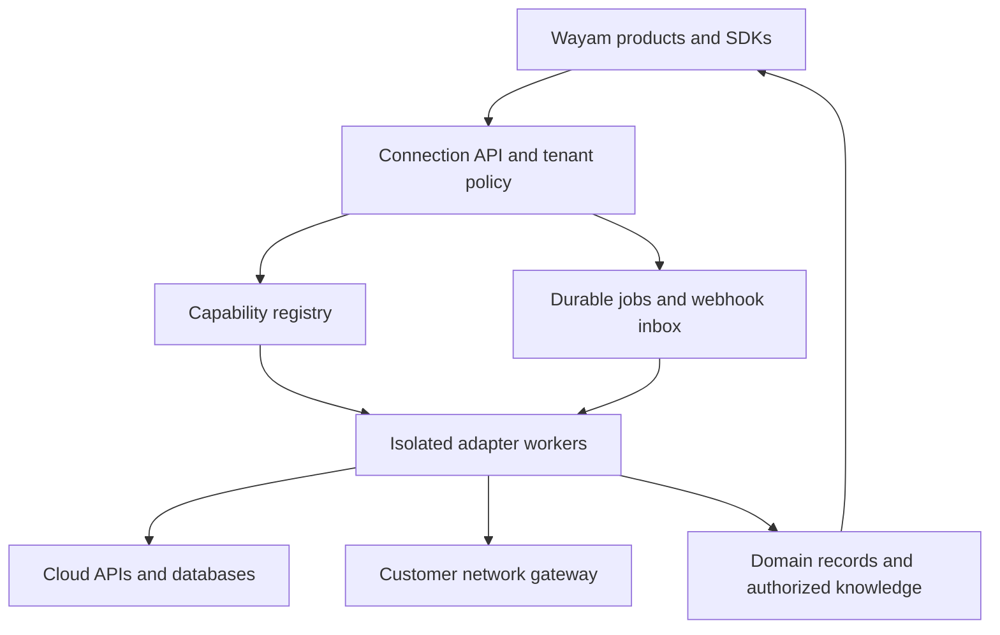

# Wayam shared connector platform

Research and implementation blueprint • 16 October 2026

## 1. Decision

Build one shared integration platform for Wayam, with provider adapters reused across products and separate mappings for finance, knowledge, manufacturing and software engineering. Own the connection registry, access policy, data contracts, evidence, testing and product SDKs. Reuse official APIs, SDKs and suitable open source for transport, extraction and parsing. Buy integration coverage where customer access and maintenance make that cheaper.

The accompanying catalog contains **294 integration surfaces across 18 categories**. This is a discovery backlog, not a claim of 294 implemented connectors or 294 distinct vendors. A surface may be a provider API, database, industrial interface, model endpoint, protocol or file parser. Shared provider families are identified so the team can avoid duplicating authentication and transport. The catalog has 191 grouped families; these are not a vendor market-share count.

**Research depth:** primary route documentation was reviewed for 21 catalog surfaces, including all 12 P0 entries, plus the open source and platform options discussed below. The remaining entries are portfolio-fit candidates with official documentation/discovery links and explicit validation-pending labels. Some enterprise links lead to a vendor portal rather than a public operation contract. They need customer implementation guides. No repository, customer account or live third-party connection was tested for this study. No market-share ranking is asserted.

The key commercial move is to launch a small set of dependable integration packs. Expand the catalog when a customer names a system, edition, required objects and buying timeline. Connector count by itself is a poor readiness metric.

## 2. Grounding in Wayam's products

| Product | What this plan uses as evidence | Integration requirement | Initial package |
|---|---|---|---|
| SAMYAK, referred to as Sumyak in the request | Current SAMYAK dossier dated 9 October: FastAPI/PostgreSQL backend, Next.js frontend; reconciliation core; ERP/bank connectors described as interface/mock; CSV import work in progress | Statements, bank transactions, ERP payments, GL and vendor context; later reviewed write-back | CSV/SFTP and statement profiles; one customer-selected ERP; payout provider |
| Bodham | Current build blueprint dated 15 October: live read-only PostgreSQL/SQL Server plus documents through Foundry IQ/Azure AI Search | Two paths: live governed queries and permission-aware document ingestion; hybrid evidence | SharePoint/OneDrive, S3, DOCX/PPTX/PDF, PostgreSQL, SQL Server |
| Chakram | User-described development harness with GitHub connection; implementation not audited here | Repositories, issues, PRs, CI evidence, preview/deployment state, later approved actions | GitHub, Actions, Jira and Vercel; then GitHub App and Bitbucket |
| Vedha | User-described agentic security validation product; implementation not audited here | CI events, authorized target context, findings/evidence export, ticketing and security-platform data | GitHub/Actions, Jira, cloud inventory; later ServiceNow/SIEM |
| Anvaya | Current dossier dated 9 October: Next.js/Prisma/PostgreSQL MRP and execution; integrations not built in that assessment | Items, BOM revisions, stock, orders, receipts, lots, quality and suppliers | Customer ERP plus file exchange; later MES/PLM/CMMS |
| Sankalp | Prior manufacturing planning brief; connector readiness not established | Plant/order/capacity data and planning outputs | Shared manufacturing pack, subject to customer validation |
| Future payer/healthcare work | Sector opportunity, not a confirmed implemented Wayam product | FHIR and contracted payer files | Customer-sponsored later pack only |

The source documents describe historical assessments, not a fresh code audit. Their exact filenames and sections are recorded in the workbook research notes. Bodham's existing blueprint specifies Foundry knowledge retrieval; this connector platform should feed that architecture. It does not require introducing another vector database.

## 3. What counts as a connector

| Layer | Example | Responsibility |
|---|---|---|
| Credential/provider core | Microsoft Graph, Google, GitHub | Consent, tokens, refresh, scoped HTTP calls, rate limits |
| Workload adapter | SharePoint files, GitHub Actions, Power BI queries | Provider-specific resources, pagination, change semantics and errors |
| Transport adapter | SFTP, REST, OData, MQTT | Secure protocol handling; no invented business semantics |
| Parser | DOCX, PPTX, MT940, CAMT | Convert bytes into typed records with source positions |
| Domain mapping | SAMYAK payment; Anvaya material | Business meaning, identities, currencies, units and reconciliation |
| Agent/tool exposure | MCP or typed tool API | Authorized discoverable operations over already governed adapters |

For PowerPoint and Word, choose the requested operation first. Downloading a `.pptx` from SharePoint and extracting its slide text needs a Graph file adapter plus a PPTX parser. Editing a presentation inside Office needs an Office add-in and host-supported APIs. Generating a new report is an output/export capability. These are separate acceptance scopes. Google Slides and Docs have their own APIs. See the Microsoft add-in documentation [S03–S04].

Power BI also needs separate query, metadata and export capabilities. Execute Queries runs DAX with tenant settings and permissions; it has result limits and service-principal restrictions for models with RLS/SSO. Do not treat it as unrestricted SQL or a generic report download [S05].

GitHub repositories, an installed GitHub App/bot and GitHub Actions share a provider core, but have different permissions and behavior. Use installation tokens and webhooks for the App. Repository reads do not automatically grant workflow dispatch, comments or checks [S06–S07].

## 4. Catalog coverage and priorities

| Category | Entries | Representative systems |
|---|---:|---|
| ERP/accounting | 25 | SAP variants, Oracle, NetSuite, Dynamics, Tally, Zoho, QuickBooks, Xero, Odoo, ERPNext |
| Banking/payments | 23 | Contracted corporate banks, Stripe, Razorpay, Cashfree, PayPal, Adyen, consented data partners |
| Documents/productivity | 21 | SharePoint, OneDrive, Google Workspace, Box, Dropbox, Notion, Confluence, Office add-ins |
| Messaging/meetings | 14 | Teams, Outlook, Slack, Gmail, Zoom, Webex |
| Work management | 13 | Jira editions, Linear, Asana, Monday, ClickUp, Azure Boards |
| Developer/CI/CD | 22 | GitHub surfaces, GitLab, Bitbucket editions, Jenkins, Vercel, registries, Figma |
| Cloud/infrastructure | 21 | AWS, Azure, GCP, Kubernetes, scoped secret adapters |
| Databases/warehouses | 25 | PostgreSQL, SQL Server, HANA, Oracle DB, Snowflake, BigQuery, Databricks, Fabric |
| BI/analytics | 12 | Power BI surfaces, Tableau, Looker, Qlik, Metabase, Superset |
| CRM/marketing | 16 | Salesforce, HubSpot, Zoho CRM, Dataverse, campaign APIs |
| HR/payroll | 10 | Workday, SuccessFactors, BambooHR, Darwinbox, greytHR, ADP |
| ITSM/identity/security | 20 | ServiceNow, Zendesk, Entra, Okta, Sentinel, Splunk, Tenable, Snyk |
| Manufacturing/engineering/IoT | 14 | Teamcenter, Windchill, Opcenter, PI, Ignition, Maximo, LIMS |
| Commerce/procurement/logistics | 13 | Shopify, Amazon SP-API, Ariba, Coupa, carriers |
| Healthcare/insurance | 8 | FHIR/SMART, Epic, Oracle Health, contracted X12 profiles |
| AI/retrieval services | 13 | OpenAI, Azure OpenAI, Gemini, Vertex, Bedrock, Anthropic, search/OCR |
| Protocols | 12 | REST, GraphQL, SOAP, OData, SFTP, SMB, Kafka, MQTT, OPC UA |
| Formats/parsers | 12 | CSV, XLSX, DOCX, PPTX, PDF, CAMT, MT940, BAI2 |
| **Total** | **294** | Includes protocols and parsers; not all unique vendors |

Every catalog entry includes an identifier, provider family, proposed product fit, concrete read scope, proposed access route, reuse approach, priority, complexity, prerequisites, documentation link, evidence depth and delivery state. Authentication fields are proposals, not validated permission contracts. The JSON and CSV are suitable inputs for a build agent; XLSX is the review and prioritization view.

Priority meanings:

- **P0 (12):** first implementation batch for reusable platform coverage. File parsers are counted explicitly as adapters.
- **P1 (26):** launch expansion, sequenced by the first paying customer. Includes SFTP, spreadsheet/PDF ingestion, Google Workspace, Tally/Zoho/QBO/Xero, payouts, identity and model/search infrastructure.
- **P1-gated (3):** SAP S/4HANA Cloud, SAP private/on-prem and SAP Business One. Start discovery alongside P0; delivery needs a design partner and exact edition.
- **P2 (183) / P2-gated (9):** broader integrations and contracted bank/AA routes, built on qualified demand.
- **P3 (53) / P3-sector (8):** later sector coverage; not a launch promise.

These are engineering recommendations rather than observed sales demand. Within each band, rank with customer evidence: signed pilot 40%, number/value of real prospects 20%, cross-product reuse 20%, confirmed access 10%, and delivery ease 10%. Record the evidence and decision owner before changing commitments; do not assign invented demand scores now.

## 5. The first twelve scopes

| Order | Surface | Acceptance scope |
|---:|---|---|
| 1 | CSV/TSV import | Customer mapping, locale, validation, repeat-file dedup and typed errors |
| 2 | PostgreSQL | Approved schemas/views, safe bounded read queries, connection test |
| 3 | SQL Server | Same contract with SQL Server identity, driver and query semantics |
| 4 | Word DOCX parser | Paragraphs/tables with deterministic source locations |
| 5 | PowerPoint PPTX parser | Slide text, tables and notes with slide-number citations; OCR marked unsupported until implemented |
| 6 | Amazon S3 | Bucket/prefix allowlist; list/fetch/version handling; delete reconciliation |
| 7 | SharePoint Online files | Selected library crawl, content and metadata; user/group ACL mapping; delta plus separate permission reconciliation |
| 8 | OneDrive for Business | Authorized drive crawl and resume; no assumption of SharePoint ACL parity |
| 9 | GitHub repositories | Repository/PR/issue/commit read scope with pagination and webhooks where supported |
| 10 | GitHub Actions | Runs/jobs/logs/artifacts ingestion; no dispatch or rerun by default |
| 11 | Jira Cloud | Allowed projects/issues/comments with incremental sync and project security |
| 12 | Vercel | Project/deployment/preview state; no deployment trigger by default |

DOCX/PPTX parser bytes come from authorized sources. A source is not pilot-ready merely because its parser works. For SharePoint, selected application access also does not prove that every Bodham user can read every indexed file. End-user authorization needs a separate ACL model [S01–S02].

Fast commercial packs:

1. **Bodham knowledge and data:** SharePoint/OneDrive or S3 plus file readers and one DB. Demonstrate a cited document answer, a live KPI and a hybrid answer with per-user access tests.
2. **SAMYAK reconciliation:** approved statement/ERP files first, then one real ERP and one payout feed. Demonstrate counts and signed amounts reconciling to source control totals. Keep finance matching in SAMYAK's deterministic engine.
3. **Chakram/Vedha engineering:** repository → PR → CI evidence → preview or vulnerability finding → reviewed ticket/report. Demonstrate provenance across the chain.

SFTP, XLSX, PDF and a real ERP belong early in the SAMYAK pilot even though the cross-product P0 list prioritizes reusable contracts. Move a qualified customer dependency forward rather than rigidly following this list.

## 6. How to obtain integrations

| Route | Best use | What Wayam still owns |
|---|---|---|
| Official SDK/API | Strategic providers, exact control, real-time calls | Consent UX, domain mappings, tests, upgrades, support |
| Open source extractor/parser | Batch data movement and file processing | License checks for pinned components, isolation, ACLs, state, product contracts |
| Hosted auth/integration service | Faster OAuth and tool breadth | Vendor abstraction, field/permission tests, costs, region, exit plan |
| Commercial unified API | Accounting/CRM/HR breadth | Coverage per edition/object, freshness, raw-data passthrough, auditability, partner contract |
| Enterprise iPaaS | Existing client SAP/Oracle middleware | Agreed interface, operations owner, deployment and chargeback |
| Customer file exchange | Legacy ERP/bank pilots | Mapping, validation, control totals, scheduling and lineage |
| Customer-network gateway | SAP ECC, Tally, SMB, private DB, industrial systems | Signed worker, outbound-only connection, mTLS, upgrades and site policies |

Start with official SDKs and a thin runtime. Evaluate Nango for authentication/product integrations and Merge/Codat for accounting coverage through a paid pilot, rather than adopting all platforms simultaneously. Merge exposes unified accounting models; Codat provides accounting/ERP/commerce integration routes [S28–S29]. They do not establish that every SAP edition or Indian bank is covered. Composio and Pipedream can accelerate tool access through hosted offerings, subject to their commercial contracts and actual operation support [S18–S19].

For each candidate partner, run the same spike: connect two tenants, read required objects and custom fields, change/delete a record, revoke access, test field-level restrictions, measure freshness and rate limits, export audit evidence, and demonstrate credential/data migration or document its limits. Compare 12-month ownership cost, not list connector count.

## 7. Open source and source-available research

“Open source”, “source available”, “SDK available” and “hosted service available” are separate properties. Below is a technical selection guide based on primary project sources accessed for this study. Pin a version/commit and record its actual license and transitive dependencies before reuse; prices and terms are not fixed by this report.

| Project | What it supplies | Observed license/scope | Wayam recommendation |
|---|---|---|---|
| dlt | Python incremental extraction/loading helpers | Apache-2.0 core [S10] | Strong batch adapter candidate; does not implement end-user document ACLs |
| Meltano | Declarative data-pipeline environment and plugin hub | MIT engine; plugin licenses vary [S11] | Use when operating multiple Singer taps warrants an environment |
| Singer SDK | Reusable tap/target framework and state patterns | Apache-2.0 SDK [S12] | Evaluate for long-tail read extractors; each tap still needs validation |
| Airbyte platform/connectors | Replication catalog and connector runtime | Current umbrella docs describe ELv2; inspect connector metadata [S13] | Optional isolated replication backend; assess embedded/managed-service fit |
| Airbyte Python CDK | API source framework and declarative extraction | CDK repository advertises MIT while newer umbrella docs use broader ELv2 language [S14, S13] | Resolve exact pinned package/license before reuse; no blanket MIT assumption |
| PyAirbyte | Python execution of Airbyte sources | Current LICENSE.md is ELv2 [S15] | Not a permissive MIT shortcut around platform restrictions |
| Nango | OAuth, tokens and product integration runtime | ELv2; cloud and enterprise features differ [S16] | Good auth/runtime pilot; verify features and commercial embedding terms |
| Activepieces | Workflow pieces and automation runtime | MIT core; designated enterprise directories commercial [S17] | Reuse eligible pieces or evaluate runtime; embedding features checked separately |
| n8n | Workflow orchestration and integration nodes | Sustainable Use License; commercial enterprise features [S20] | Current FAQ distinguishes internally authored client workflows from external users configuring them; check exact Wayam product flow |
| Apache Camel | Routing and a large component ecosystem | Apache-2.0 [S21] | Strong Java integration/gateway option for enterprise protocols |
| Apache NiFi | Managed dataflow and processors | Apache-2.0 [S22] | Consider for customer-managed data movement; operationally heavier |
| Debezium | Database change capture | Apache-2.0 core; noted subcomponent exceptions [S23] | Add when justified by freshness/volume; CDC is not a finance business API |
| Temporal | Durable workflow execution/retries | MIT server [S24] | Later orchestration upgrade if durable long-running flows justify it |
| Composio SDK | Client SDK and provider adapters for hosted toolkits | MIT SDK repository; hosted toolkit backend/service separate [S18] | Evaluate hosted tool access; do not claim entire backend is self-hostable |
| Pipedream components | Public integration components and hosted platform | Source Available License excludes commercial uses as stated in root license [S19] | Evaluate commercial service; no unrestricted copy into Wayam |
| MCP reference servers | Protocol/SDK examples | Reference implementation scope [S25] | Learn from them; project expressly says these are not production-ready solutions |
| MCP Toolbox for Databases | Database tools exposed to agent clients | Apache-2.0 repository [S26] | Evaluate curated query tools behind Bodham policy |
| Docling | Structured document conversion/OCR | MIT code; model dependencies reviewed separately [S27] | Good PDF/layout reader candidate |
| MarkItDown | Office/file-to-Markdown conversion | MIT [S30] | Good broad text reader; evaluate extraction fidelity per format |
| Unstructured | Document partitioning/extraction | Apache-2.0 project; hosted service separate [S31] | Alternative parser; review dependencies and telemetry settings |
| LangChain | Agent/tool and document-loader libraries | MIT repository; packages/services separately checked [S32] | Optional orchestration/loaders; no replacement for sync/ACL platform |
| LlamaIndex | Data/document loaders and retrieval components | MIT repository; hosted offerings separate [S33] | Optional ingestion helpers; evaluate each integration dependency |
| SAP PyRFC | SAP RFC bindings | Archived 28 May 2026; separate SAP NW RFC SDK dependency [S34] | Do not choose as the new default without supported-runtime plan; prefer released APIs where available |

The 2026 licensing findings materially change older advice: PyAirbyte is currently ELv2; Airbyte blanket claims that “all connectors are MIT” are unreliable; and n8n's current support FAQ allows some internally authored client workflows but requires commercial licensing when external users configure workflows, including through an AI agent [S13–S15, S20]. Keep this evidence next to the dependency decision.

Recommended minimal starting set: official provider SDKs + FastAPI/Pydantic + HTTP client; one parser stack; PostgreSQL job/state store; optional dlt for a proven batch use case. Add one external integration vendor only after a comparative spike. Avoid running Airbyte, NiFi, Camel, n8n and Temporal together in the first version.

## 8. Platform architecture

Proposed stack follows the current Python/FastAPI and TypeScript product mix. Use FastAPI/Pydantic for the connection API and Python connector workers, PostgreSQL for metadata/jobs, encrypted object storage for retained raw evidence, Azure Key Vault for production secret references, Entra/OIDC identities, OpenTelemetry and Azure Container Apps where suitable. Generate TypeScript and Python client SDKs from OpenAPI. TypeScript workers are optional for a provider library that warrants them; do not maintain every adapter in two languages.

A PostgreSQL-backed queue with leases, retries and an outbox is sufficient for the first batch if tested under worker crashes. A later Temporal decision is an architectural decision record, not a hidden mandatory dependency. Long-running tests and private gateways need deployment options beyond an ephemeral request handler.

Separate capability interfaces: `ConnectionCheck`, `ResourceDiscovery`, `RecordSync`, `DocumentFetch`, `PermissionSync`, `BoundedQuery`, `WebhookReceiver`, `ReviewedAction`, `ArtifactExport`, and `Inference`. An adapter implements only supported capabilities. No empty methods returning success, universal `execute(command)` escape hatch, or assumption that every source supports delete events and incremental sync.

The registry records provider/edition, adapter version, auth modes, exact scopes and endpoints, schemas, capabilities, source-supported limitations, rate policy, cursor format version, mapping version, evidence level, owner, status and last live test. Reject unsupported operations explicitly.

### Core storage and contracts

Use tenant-scoped tables for `connector_definition`, `connection`, `credential_ref`, `capability_grant`, `sync_job`, `sync_partition`, `checkpoint`, `raw_object_ref`, `normalized_record`, `source_acl`, `webhook_inbox`, `outbox`, `action_request` and `audit_event`. Tenant ID comes from authenticated identity; workers receive a scoped job grant. Enforce database isolation as well as application filtering. Uniqueness includes tenant, connection, source object and source version/event.

The common envelope contains tenant, product grant, connection, source system/edition, source object ID, resource type, schema/mapping version, source version, event ID, source/update/observation timestamps, operation (`upsert`, `delete`, `acl_change`), checksum, provenance link, raw evidence reference and ACL reference. Keep raw source fields in a namespaced extension rather than discarding fields to fit a universal model.

Domain records remain separate:

- Finance: BankAccount, Statement, BankTransaction, LedgerAccount, JournalLine, Payment, Invoice, Counterparty, Settlement. Use decimal amounts or integer minor units with explicit currency; no binary floating-point money. Preserve original debit/credit sign, booking/value dates, reversal relationships, legal entity and account identity. Matching and journal approval belong to SAMYAK.
- Knowledge: Document, DocumentVersion, Fragment, Principal and SourcePermission. Preserve page/slide/sheet/source anchors. Do not turn a structured workbook into an unsupported “fully recalculated” table.
- Manufacturing: Material, UoM, BOMRevision, StockPosition, Lot, SalesOrder, PurchaseOrder, WorkOrder, QualityResult. Preserve plant, warehouse, effective dates and approved unit conversions.
- Engineering: Repository, Commit, PullRequest, WorkItem, WorkflowRun, Artifact, Deployment, Finding. Link objects through immutable provider IDs and provenance.

### Sync correctness

Persist batches and checkpoint advancement with an outbox/transaction boundary so a crash cannot silently skip records. Use at-least-once processing plus idempotent upserts, not an unsupported exactly-once promise. Order watermarks with stable tie-breakers; use overlap windows for late updates. Partition state by connection/resource. Record partial failures and quarantine malformed rows without pretending the entire sync succeeded.

Provider deltas, change feeds and webhooks are signals with different guarantees. Track cursor expiry and rebuild strategy. Use periodic reconciliation where events/deletions/ACL changes are incomplete. A full crawl may infer deletions only after the entire authorized scope finishes successfully; a partial crawl must not delete unseen data. Microsoft and Google both document change-tracking APIs, but their contracts differ [S01, S09].

### Authorization and knowledge

Authentication proves a connection's identity; it does not define which product user may read the fetched content. Map source users/groups to Wayam principals, store ACL versions, enforce tenant and product grants, and filter retrieval before content reaches the model. Group removals, moves, sharing-link changes and revocations need tests. Do not treat an application's broad crawl permission as a grant to every employee.

Proposed pilot targets: process known revocations immediately; observe and apply supported permission updates within five minutes; expire permission evidence after 15 minutes unless revalidated. These are Wayam design targets to test, not provider guarantees. Sources unable to meet them require a tighter source-time access check or withheld content. Source disconnection blocks access immediately and triggers policy-driven derivative deletion. ACL refresh failures and unknown identities fail closed.

For on-prem systems, deploy an outbound-only agent using mTLS and short-lived job grants. It exposes allowlisted resource reads, not remote shell access. Keep SAP SDKs or industrial libraries in customer-approved images, record versions and ownership, and avoid exposing Tally/SMB/DB ports to the internet.

## 9. Testing and release evidence

Each adapter needs independent tests of provider behavior and its domain mapping. The workbook contains 48 proposed test scenarios and the Claude prompt specifies the test harness. These tests have not been implemented or run in this research task.

Test levels: deterministic unit tests → provider contract fixtures → isolated dependency integration tests → vendor sandbox live tests → customer pilot UAT. A missing key or customer network produces a blocked live test, never a fabricated pass. Fixture coverage establishes local behavior only.

Critical cases include token expiry and refresh races; tenant isolation; ACL removal; duplicate/out-of-order events; expired cursors; worker crash before/after checkpoint; pagination cycles; partial HTTP 200 errors; 429/Retry-After; malformed files; zip bombs; stale query results; currency/sign mistakes; source-total mismatch; and silent truncation. Power BI specifically can return HTTP 200 with errors/partial data; inspect the result body [S05].

Status model: `candidate` → `contract_ready` → `fixture_tested` → `sandbox_verified` → `pilot_verified` → `supported`. Keep `blocked`, `degraded` and `retired` separate. Offline/local sources use `local_integration_verified` instead of inventing a vendor sandbox. Public marketing “supported” requires declared scope, live/customer evidence where relevant, an owner, tested upgrade path and support policy.

## 10. Build sequence and planning assumptions

| Period | Deliverable | Exit evidence |
|---|---|---|
| Days 1–5 | Product/source inventory, exact first-customer objects, provider/OSS spikes, contracts and decisions | Required fields, edition, credentials owner, current docs and license evidence |
| Weeks 2–3 | Registry, tenancy, credential references, queue/outbox, SDKs, contract harness | Two-tenant isolation; resumable job; expired token and secret-redaction tests |
| Weeks 4–5 | CSV + DB + DOCX/PPTX vertical slices | Local integration evidence; correct domain/provenance mapping |
| Weeks 6–8 | S3 + SharePoint/OneDrive and permission sync | Live sandbox reads, update/delete/revoke behavior, Bodham evidence path |
| Weeks 8–10 | GitHub/Actions + Jira + Vercel | CI/PR/deployment lineage and failure/replay cases |
| Weeks 11–14 | Customer pilots, deployment hardening and launch support | UAT, measured freshness/cost, recovery exercise, runbooks |

This is an initial estimate for **four engineers plus shared QA/security/product support**, with usable test tenants and timely customer access. Work overlaps after contracts settle. It is not a fixed-price commitment. One or two engineers should expect a longer schedule. Agent-generated implementation does not remove onboarding, semantic mapping or live UAT.

In parallel, secure one finance design partner for Tally/Zoho/QBO or a clearly specified SAP edition. SAP discovery can start in week one without being on the critical path for the other packs. Manufacturing PLM/MES and healthcare belong in separately sponsored delivery tracks.

Complexity labels in the catalog are relative estimates after the shared core: S approximately 2–4 engineer-days, M 5–10, L 10–25, XL 25–60+ for a bounded initial read scope and its tests. They exclude customer waiting, certification and production support. Do not sum every row as a reliable portfolio quote; shared cores reduce some work while custom mappings add work.

Cost comparison should capture engineering plus maintenance, hosted connected-account/task/token charges, egress, parser/OCR/model usage, private gateway operations, test licenses and support. Ask vendors for quotes against the same scenario: active customer connections, daily volume, freshness, peak events and retention. No current paid-plan price is assumed here.

## 11. Operating the catalog and going to market

Require this intake before a connector becomes a delivery promise: product and buyer; system/edition/version/region; source objects and fields; read/query/write direction; expected volume/freshness; user/tenant access model; identity/consent owner; sample data; sandbox availability; network route; licensing/partner dependencies; retention; and a signed-off acceptance example.

Publish a capability card with supported operations and editions, tested identity mode, freshness, custom-field behavior, regional availability, supported data volume, known limitations and last verification. “SAP supported” is too broad; “SAP Business One Service Layer, read-only incoming/outgoing payments for an agreed version” is reviewable. SAP's Business One documentation describes its Service Layer and version behavior [S08].

Measure setup-to-first-success, sync success and lag, delete/ACL lag, mapping error rate, recovery time, test-tenant uptime, cost per active connection and engineering hours per connector. Suggested pilot gates are zero demonstrated cross-tenant/ACL leaks, zero unexplained finance-total differences, successful crash/replay recovery and explicit user-visible stale/blocked status. Reliability targets should be set from the first measured pilot rather than asserted without operating evidence.

Assign one owner per provider family. Pin SDK and API versions; use automated dependency-update PRs with contract/live-canary tests. Review provider changelogs, license changes and API deprecations. Deploy upgrades to test tenants before customers. “Always latest” should mean a monitored, tested upgrade process, not unpinned production dependencies.

## 12. How to use the implementation pack

Give Claude the build prompt, catalog JSON/CSV, strategy and the actual repository. The prompt starts with the shared core and P0 batch, then advances through qualified waves. Claude should continue local build/test/fix cycles while recording credential blockers. It should not generate hundreds of untested stubs and label them complete.

Wayam review should focus first on the core contract and one complete vertical slice, then sandbox evidence and domain invariants. Expand only when the test and support cost is understood. The final code remains subject to Wayam's review; this pack is a researched implementation specification, not delivered connector code.

## Sources and evidence register

All URLs below were retrieved or surfaced through primary sources during this study on 16 October 2026. Where source pages disagree, the uncertainty is retained. Catalog candidate links without reviewed-route status are discovery leads, not verified endpoint specifications.

| ID | Primary source |
|---|---|
| S01 | [Microsoft Graph driveItem delta](https://learn.microsoft.com/en-us/graph/api/driveitem-delta) |
| S02 | [Selected permissions in OneDrive/SharePoint](https://learn.microsoft.com/en-us/graph/permissions-selected-overview) |
| S03 | [PowerPoint add-ins](https://learn.microsoft.com/en-us/office/dev/add-ins/powerpoint/powerpoint-add-ins) |
| S04 | [Word add-ins](https://learn.microsoft.com/en-us/office/dev/add-ins/word/word-add-ins-programming-overview) |
| S05 | [Power BI Execute Queries](https://learn.microsoft.com/en-us/rest/api/power-bi/datasets/execute-queries) |
| S06 | [GitHub App authentication](https://docs.github.com/en/apps/creating-github-apps/authenticating-with-a-github-app/about-authentication-with-a-github-app) |
| S07 | [GitHub Actions REST API](https://docs.github.com/en/rest/actions) |
| S08 | [SAP Business One Service Layer reference](https://help.sap.com/doc/056f69366b5345a386bb8149f1700c19/10.0/en-US/Service%20Layer%20API%20Reference.html) |
| S09 | [Google Drive changes](https://developers.google.com/workspace/drive/api/guides/manage-changes) |
| S10 | [dlt repository](https://github.com/dlt-hub/dlt) |
| S11 | [Meltano repository](https://github.com/meltano/meltano) |
| S12 | [Singer SDK repository](https://github.com/meltano/sdk) |
| S13 | [Current Airbyte licensing](https://github.com/airbytehq/airbyte/blob/master/docs/community/licenses/README.md) |
| S14 | [Airbyte Python CDK](https://github.com/airbytehq/airbyte-python-cdk) |
| S15 | [PyAirbyte current license](https://github.com/airbytehq/PyAirbyte/blob/main/LICENSE.md) |
| S16 | [Nango license](https://github.com/NangoHQ/nango/blob/master/LICENSE) |
| S17 | [Activepieces licensing](https://github.com/activepieces/activepieces/blob/main/docs/about/license.mdx) |
| S18 | [Composio SDK repository](https://github.com/ComposioHQ/composio) |
| S19 | [Pipedream root license](https://github.com/PipedreamHQ/pipedream/blob/master/LICENSE) |
| S20 | [Current n8n use-case licensing FAQ](https://support.n8n.io/article/can-i-use-your-license-for-my-use-case) |
| S21 | [Apache Camel](https://github.com/apache/camel) |
| S22 | [Apache NiFi](https://github.com/apache/nifi) |
| S23 | [Debezium](https://github.com/debezium/debezium) |
| S24 | [Temporal](https://github.com/temporalio/temporal) |
| S25 | [MCP reference server limitations](https://github.com/modelcontextprotocol/servers) |
| S26 | [MCP Toolbox for Databases](https://github.com/googleapis/mcp-toolbox) |
| S27 | [Docling](https://github.com/docling-project/docling) |
| S28 | [Merge accounting API](https://docs.merge.dev/merge-unified/accounting/overview) |
| S29 | [Codat accounting integrations](https://docs.codat.io/integrations/accounting/overview/) |
| S30 | [Microsoft MarkItDown](https://github.com/microsoft/markitdown) |
| S31 | [Unstructured](https://github.com/unstructured-io/unstructured) |
| S32 | [LangChain license](https://github.com/langchain-ai/langchain/blob/master/LICENSE) |
| S33 | [LlamaIndex license](https://github.com/run-llama/llama_index/blob/main/LICENSE) |
| S34 | [Archived SAP PyRFC](https://github.com/SAP-archive/PyRFC) |
| S35 | [TallyPrime integration](https://help.tallysolutions.com/integrate-with-tallyprime/) |
| S36 | [Jira Cloud REST](https://developer.atlassian.com/cloud/jira/platform/rest/v3/intro/) |
| S37 | [Vercel REST](https://vercel.com/docs/rest-api) |
| S38 | [Python CSV](https://docs.python.org/3/library/csv.html) |
| S39 | [PostgreSQL documentation](https://www.postgresql.org/docs/current/) |
| S40 | [SQL Server drivers](https://learn.microsoft.com/en-us/sql/connect/) |
| S41 | [Amazon S3 API](https://docs.aws.amazon.com/AmazonS3/latest/API/Welcome.html) |
| S42 | [python-docx](https://python-docx.readthedocs.io/) |
| S43 | [python-pptx](https://python-pptx.readthedocs.io/) |

Internal evidence read: `SAMYAK_PRODUCT_DOSSIER.md` §§1–3; `ANVAYA_PRODUCT_DOSSIER.md` §§1–2; `Bodham_Agent_Build_Blueprint.md` §§1–4. Additional user-described product context is explicitly labeled in section 2.
